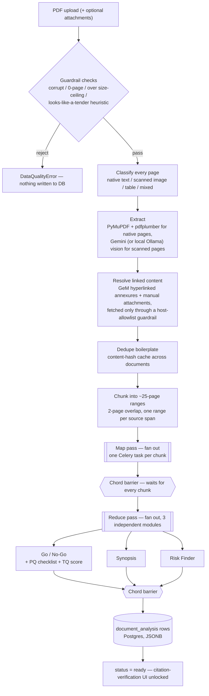
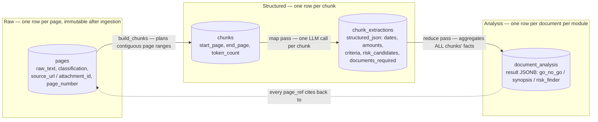
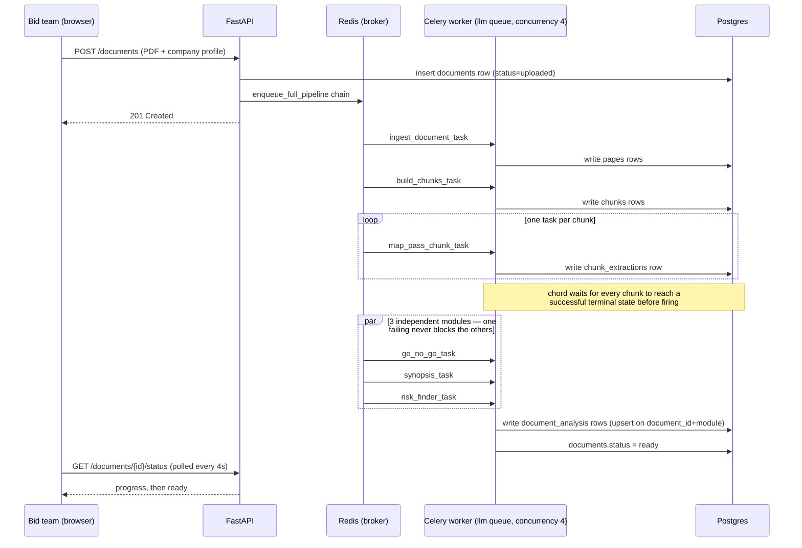
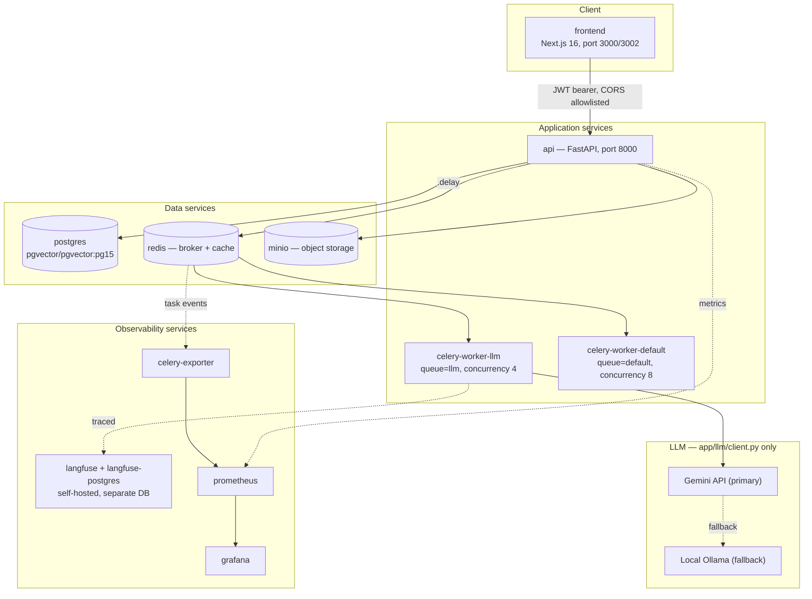

# Architecture — Tender AI Platform

Filled in during Phase 8 (Observability & Ship), against the actual running code, not
the original implementation plan. For file-by-file backend detail, read
`docs/BACKEND_GUIDE.md`; for the "why" behind any choice below, read
`docs/DECISIONS.md` (cited inline by number). This file stays diagram-and-summary
only — it does not re-explain what those two files already cover well.

**Last verified against the code**: 2026-10-16 (primary LLM provider is the Gemini
API, not Ollama Cloud — `docs/DECISIONS.md #76` superseded `#28`; chunk size is 25
pages, not 5 — `#77` superseded `#35`). If a future change moves either of those again,
update this line along with the diagrams below, not just `docs/DECISIONS.md`.

This is a **Celery-orchestrated map-reduce pipeline** — classify → extract → dedupe →
chunk → map → reduce → serve — explicitly not an agent and not RAG (`docs/SPEC.md`
§2.1/§10, `docs/DECISIONS.md #4`): every stage is fixed at design time, nothing decides
at runtime which tool to call or whether to retrieve again, and every page of every
document is read in full rather than selectively retrieved.

---

## Pipeline diagram (ingestion → storage → two-pass AI → serving)

## Data flow through the three DB layers (raw → structured → analysis)

Each layer is a distinct set of tables, not just a naming convention — the raw layer
never gets rewritten once ingestion completes, so a citation always resolves against
the exact same text the model actually saw.

## Sequence diagram: upload → Celery chain/chord → document_analysis rows

## Deployment diagram (docker-compose services)

> **Not yet verified end-to-end**: the `langfuse`, `prometheus`, `grafana`, and
> `celery-exporter` services are fully defined in `docker-compose.yml` but have not
> been run end-to-end in this dev environment, which has no Docker
> (`docs/DECISIONS.md #54`). Every other service above has been run for real.

---

## Tech stack summary

| Layer | Technology | Production-grade today? |
|---|---|---|
| Frontend | Next.js 16 (App Router) + Tailwind v4 | UI: yes. Auth is a single shared credential, not per-user. |
| API | FastAPI + Pydantic v2, Python 3.11+ | Yes. |
| Orchestration | Celery + Redis (chain/chord) | Yes, but a single Redis instance — no HA. |
| Database | PostgreSQL + SQLAlchemy + Alembic | Schema: yes. Hosting: a colleague's own machine over Tailscale, not managed/clustered. |
| Object storage | MinIO (dev) → S3/R2 (prod) | Dev-only today; the prod swap is a config change (`docs/DECISIONS.md #11`). |
| LLM provider | Gemini API (primary) + local Ollama (fallback) | Functionally resilient and traced; no commercial SLA/contract. |
| Auth | Single shared JWT credential | Fine for a Tier-2 pilot (`docs/DECISIONS.md #2`/`#44`); not audit-ready. |
| Tracing / metrics | Self-hosted Langfuse, Prometheus, Grafana | Defined, not yet run end-to-end (see caveat above). |
| Vector search | pgvector extension | Enabled, zero vector columns in use — no retrieval step exists. |

---

## Bronze/Silver/Gold export layer (docs/DECISIONS.md #17)

A colleague independently designed a 4-table schema for the company/tender data
(`company_master_profile`, `tender_bronze_raw`, `tender_silver_extracted`,
`tender_gold_analysis`), presumably for downstream reporting/BI consumption. It's
chunk-level (a `page_range` string like `"Pages 1-20"`) rather than page-level, so it
can't support exact-page citation on its own — the spec's core "every risk flag citing a
real page" requirement needs our page-level schema (§3.1 of the spec) as the system of
record. Per the user's decision, **our schema stays canonical**; the colleague's 4 tables
are treated as a **derived export/reporting view**, synced from it, not an alternative
source of truth. Both schemas' DDL are applied verbatim — neither is redesigned to
accommodate the other.

**This export/sync logic is Phase 5+ work** (it needs `document_analysis` rows to exist)
— not built yet. Recorded here now, while the mapping is fresh, so Phase 5 implements it
against a plan instead of improvising one.

### Table mapping

| Colleague's table | Derived from (our schema) | Mapping notes |
|---|---|---|
| `company_master_profile` | `company_profiles` | `company_id` (SERIAL) has no natural counterpart to our UUID `id` — on sync, look up an existing export row by a hidden `profile_data._source_company_profile_id` field (set to our UUID) before inserting, so re-syncs upsert rather than duplicate. `profile_data` = the full `company_profiles` row serialized as one JSON object (turnover, certifications, past_projects, etc. all nested, matching their "unified JSON representation" intent). |
| `tender_bronze_raw` | `chunks` (one row per chunk, not per page) | `tender_id` = `str(documents.id)`. `chunk_sequence` = 1-indexed order by `chunks.start_page`. `page_range` = `f"Pages {start_page}-{end_page}"` — this is where citation precision is lost in the export view; internal citations still resolve against `pages.page_number`, never against this string. `raw_text` = concatenation of the constituent pages' `raw_text`, in page order. |
| `tender_silver_extracted` | `chunk_extractions` | `bronze_chunk_id` = the `tender_bronze_raw` row created for the same `chunk_id`. `extracted_requirements` = `chunk_extractions.structured_json` as-is. |
| `tender_gold_analysis` | `document_analysis` (all 3 module rows, merged into one) | `tender_id` = `str(documents.id)` (`UNIQUE`, matching our own `UNIQUE(document_id, module)` upsert semantics — one gold row per tender). `go_nogo_status`/`go_nogo_score` = the `go_no_go` module's `decision`/`score`. `match_report` = `{"criteria_matches": ..., "gaps": ..., "synopsis": <the synopsis module's full result>}` — **the colleague's schema has no dedicated synopsis field**; nesting it inside `match_report` is a deliberate compatibility choice so their DDL isn't altered unilaterally. Flag to the colleague: a dedicated `synopsis JSONB` column would be cleaner if they're open to a small migration on their side. `document_roadmap` = the `go_no_go` module's `next_steps`. `risk_matrix` = the `risk_finder` module's full result. |

### What does NOT get exported
`pages`, `extracted_tables`, and `boilerplate_cache` have no equivalent in the colleague's
schema and aren't exported — they're purely internal to how we guarantee exact-page
citation and cross-document dedupe, which the export layer's consumers don't need.
